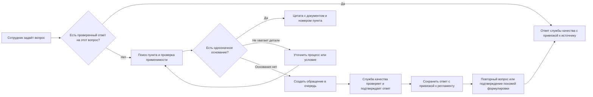
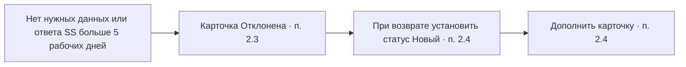

# Сценарий демо ИИкузницы

Бриф требует показать ответы по регламентам, уточняющий диалог и пополнение базы проверенными ответами. Веб-форма разрешена. Схемы ниже показывают поведение агента и один переход из регламента. Они помогают объяснить реализацию на питче. [Бриф заказчика](https://drive.google.com/file/d/106oM6N4qwa-U0PVxKHNsSm8XQYdsodLF/view)

## Процесс агента

## Возврат отклонённого проекта Дирекции ИБ

В интерфейсе показаны действия сотрудника. Статус CRM агент не меняет. [Регламент Дирекции ИБ](https://drive.google.com/file/d/1gujKSVIlDCSJsXxBeGGZ3D0mHjXCCtvc/view)

## План непрерывной записи

| Время | Что показать |
| --- | --- |
| 00:00–00:35 | Вопрос «Проект отклонили. Как снова запустить его в работу?». Уточнить Дирекцию ИБ. Показать статус «Новый», дополнение карточки и два пункта источника. |
| 00:35–01:15 | Вопрос о расхождениях в себестоимости. Выбрать «Меняют». Показать применимую ветку п. 3.5 и возможность задать новый вопрос. |
| 01:15–02:35 | Вопрос без подтверждённого ответа. Показать номер обращения, открыть очередь, внести подтверждённый ответ с источником и повторить вопрос. В учебной репетиции роль службы качества выполняет демонстратор. |
| 02:35–02:55 | Показать проверенный ответ с привязкой к регламенту. Для финальной записи убедиться, что виден адрес стенда и секреты не попали в кадр. |

Формат сдачи — ссылка на видео до трёх минут, одним фрагментом на данных задачи. [Положение, п. 4.5](https://xn--80ancabkw0c4a.xn--p1ai/regulations/v1.html)
