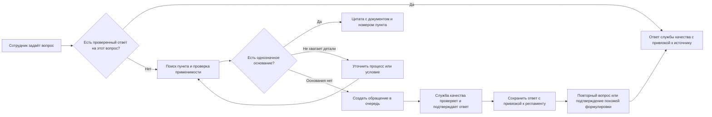
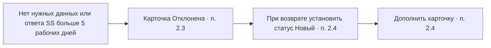

# Сценарий демо ИИкузницы

Бриф требует показать ответы по регламентам, уточняющий диалог и пополнение базы проверенными ответами. Веб-форма разрешена. Схемы ниже показывают поведение агента и один переход из регламента. Они помогают объяснить реализацию на питче. [Бриф заказчика](https://drive.google.com/file/d/106oM6N4qwa-U0PVxKHNsSm8XQYdsodLF/view)

## Процесс агента

## Возврат отклонённого проекта Дирекции ИБ

В интерфейсе показаны действия сотрудника. Статус CRM агент не меняет. [Регламент Дирекции ИБ](https://drive.google.com/file/d/1gujKSVIlDCSJsXxBeGGZ3D0mHjXCCtvc/view)

## Сценарий записи с озвучкой

1. Задать вопрос о шаблоне договора для конкурсного проекта. Показать уточнение по п. 7.2 Технической дирекции, затем обе ветки по отдельности.
2. Спросить, куда направить запрос на перенос активированной лицензии на другое юридическое лицо. Показать обращение №1 и открыть защищённую очередь.
3. В роли сотрудника службы качества подтвердить учебный ответ и указать связанный регламент.
4. Спросить, кому писать, чтобы переоформить использованный ключ на новую организацию. Подтвердить совпадение и показать ответ обращения №1.
5. Спросить об отмене переноса. Показать отдельное обращение №2.

Репетиция проводится на отдельной базе. Ответ обрабатывает учебное обращение и служит демонстрацией пополнения базы. Допустимая длина видео до трёх минут. [Положение, п. 4.5](https://xn--80ancabkw0c4a.xn--p1ai/regulations/v1.html)
